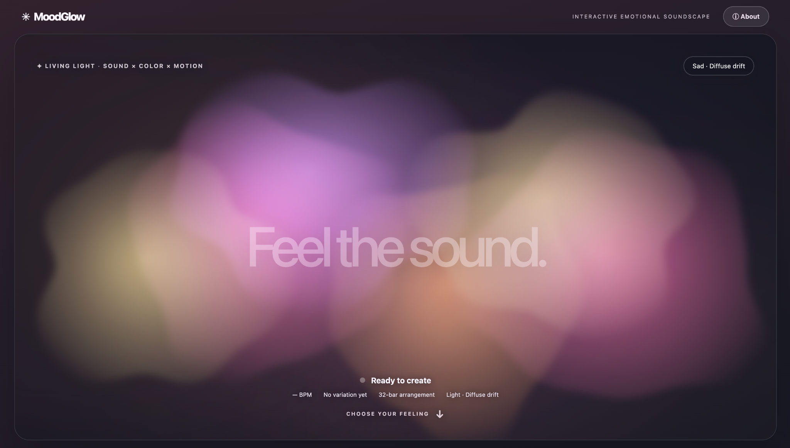

# MoodGlow

*An interactive emotional soundscape*




## Overview

MoodGlow is a browser-based experience that combines procedurally arranged instrumental music with flowing, animated light. It is designed for people who want a short, creative way to explore a mood and choose the kind of atmosphere they would like to experience. It is an expressive interface, not an emotion-recognition tool or a therapeutic treatment.

The central interaction is choice → music and light response → feedback → another choice.


## How to interact

1. Under How are you feeling?, choose Sad, Stressed, Tired, or Okay. This controls the light's shape and movement.
2. Under How would you like to feel?, choose Uplifted, Calm, or Refreshed. This controls the musical arrangement and light color palette.
3. Select Generate & Play to start a looping instrumental arrangement and animated light.
4. Change the current mood while the music is playing to compare light behaviors without restarting the soundtrack. Choose Regenerate to hear a new musical variation.
5. Select Stop to end the audio and return to the choices. Stop before changing the desired feeling; the ambient light can continue to drift while idle.

Current mood affects the visuals, not the soundtrack. For example, Sad → Uplifted and Tired → Uplifted use the same musical style and color palette, but display different light motions.


## Sound and light design


| Input | Result |
| --- | --- |
| Sad | Soft, dispersed light islands that drift and overlap |
| Stressed | Crossing, directional bands of light |
| Tired | Vertical light columns that gradually appear, rise, and fade |
| Okay | Balanced, orbiting, fluid light forms |
| Uplifted | Energetic, pop arrangement; faster light flow |
| Calm | Gentle arrangement; blue-violet palette and slower light flow |
| Refreshed | Retro-inspired electronic-pop groove; mint-teal palette and medium light flow |

Each soundtrack uses a 32-bar procedural arrangement and loops until stopped. Uplifted is scheduled using JavaScript and plays bundled WAV samples through the Web Audio API. Calm and Refreshed use Strudel (`@strudel/web@1.0.3`) for pattern playback. The animation follows calculated musical beat and accent events; it does not analyze microphone input or live audio frequencies.


## How to run

Requirements: Python 3, desktop browser (tested in Chrome), speakers or headphones, and internet access for the Strudel library used by Calm and Refreshed. No paid account or API key is required.

1. Download or clone this repository.
2. Open Terminal in the repository's root folder.
3. Start a local web server:
```bash
python3 -m http.server 8000
```

4. Open http://localhost:8000 in Chrome.
5. Select your feelings, then click Generate & Play. Browser audio requires a user click.
6. Press Control + C in Terminal to stop the local server.

Do not open `index.html` directly with a `file://` URL, because bundled audio is fetched from the local server.


## Files

- `index.html` — interface, controls, and About dialog.
- `styles.css` — layout, typography, and interface styling.
- `app.js` — selections, music generation, playback, and accent timing.
- `glow-visual.js` — mood-specific animated light rendering.
- `sounds/` — bundled WAV samples for Uplifted.
- `test_logic.cjs` — JavaScript regression checks (run with `node test_logic.cjs` if Node.js is installed).
- `PROCESS.md` — decisions, iteration, testing, and AI-use disclosure.

## Known limitations

- Calm and Refreshed depend on an external Strudel script; without a network connection, those soundtracks may not play. Uplifted uses bundled local samples.
- Light synchronization is based on generated patterns and a browser animation clock. Especially for Strudel playback, the visual response may be slightly offset from audible events.
- Music is rule-based, not generated by an AI audio model. MoodGlow does not infer how a person feels.
- This is a desktop-first prototype; browser performance, rendering, and sample playback can vary across devices.
- The Audio diagnostics & extra instruments section is a development/testing aid, not part of the primary interaction.

## Credits and Tools

- Strudel — pattern-based browser music system, integrated through `@strudel/web@1.0.3` (AGPL-3.0-or-later). See its license and integration guidance.
- Web Audio API / Canvas API — browser features used for sample playback and animated light.
- ChatGPT — assisted with prototype code, debugging, implementation alternatives, and test planning. I directed the design decisions, tested iterations, and evaluated the results. See `PROCESS.md` for details.
- All WAV files in `sounds/` are project-specific synthesized samples. No commercial reference tracks are bundled in the application.
